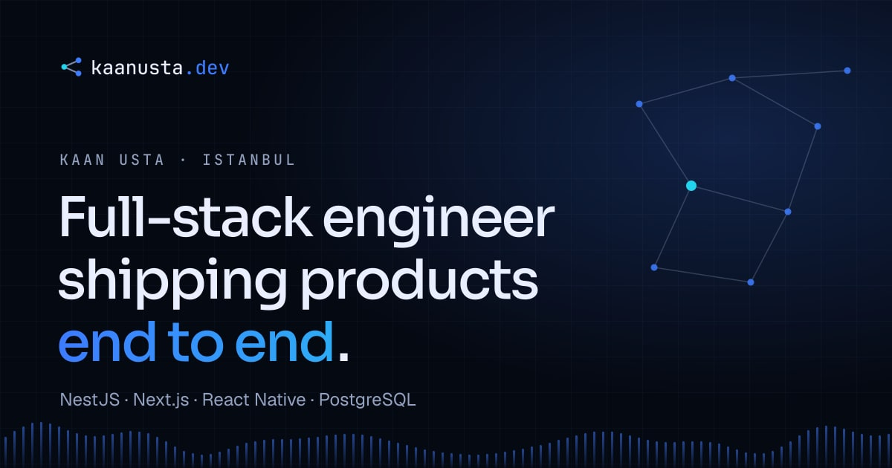

# kaanusta.dev

Personal site and blog for **Kaan Usta** — full-stack engineer (NestJS, Next.js, React Native), building Patimania end to end; Unity / C# games before that.

**Live:** [kaanusta.dev](https://kaanusta.dev)



## Highlights

- 📈 Hero with a live data canvas (streaming bars, node network) and a pre-written Q&A box
- 🧭 Scroll-driven sections: Patimania dataset card, career pipeline graph, skills map, evals
- 🎮 Seven projects (Patimania + six games) with cover + gallery + lazy-embedded YouTube trailers
- 🪟 Project modal that fetches and injects detail pages over the current page, with full deep-link + View Transitions support
- 🌙 Dark-first navy design with blue / cyan accents, light theme included, reduced-motion aware
- 🌍 English at `/`, Turkish mirror at `/tr/`
- 💬 Private, password-protected Claude chat at `/chat` (see [Chat](#chat))

## Stack

- [Astro 5](https://astro.build) static site + content collections
- [Tailwind CSS](https://tailwindcss.com) (custom theme in `tailwind.config.mjs`, CSS variables in `src/styles/global.css`)
- TypeScript
- Self-hosted [Sora](https://fonts.google.com/specimen/Sora), [Geist](https://vercel.com/font) and [JetBrains Mono](https://www.jetbrains.com/lp/mono/) via `@fontsource` (Inter for `/chat`)
- GitHub Pages + GitHub Actions for deploy

## Local development

```sh
npm install
npm run dev              # http://localhost:4321
npm run dev -- --host    # also expose on LAN for phone testing
npm run build            # production build to dist/
npm run check            # type-check .astro / .ts files
npm run preview          # serve the production build locally
```

## Project structure

```
src/
  content/
    projects/     # one markdown file per project (frontmatter-driven)
    blog/         # blog posts
  assets/
    projects/     # per-project cover + gallery images
    portrait-*    # hero photo layers (bg + cut-out) and square / wide crops
  components/     # Header, Footer, ProjectCard, ProjectModal, ...
    home/         # home page sections (hero canvas, Q&A, AI studio, career, skills, ...)
  layouts/        # BaseLayout (head, nav, footer)
  views/          # page bodies shared by the EN and TR routes (take a `lang` prop)
  pages/          # EN routes — thin wrappers around views/ (+ chat, privacy pages)
    tr/           # TR mirror of the public routes
  styles/
    global.css    # CSS variables, @layer components, prose styles
  lib/
    constants.ts  # site + social + nav + chat settings
    home.ts       # home page copy and data, EN + TR
    i18n.ts       # EN / TR UI strings and path helpers
    content.ts    # collection queries (per-locale, sorted) + slug helper
public/
  favicon.svg
  og-image.jpg
  chat/           # /chat PWA manifest, icons, service worker
  scripts/        # is:inline JS (project modal)
  drawrush-privacy/
scripts/
  og-image.svg    # source for the OG image — regenerate with sharp
  chat-icon.svg   # source for the /chat app icons
worker/           # Cloudflare Worker behind /chat (deployed separately)
```

## Adding a project

1. Drop cover + gallery images under `src/assets/projects/<slug>/` (cover.png, gallery/01.png, ...)
2. Create `src/content/projects/<slug>.md` — match the frontmatter schema defined in `src/content.config.ts` (title, platform, genres, year, duration, role, description, techStack, links, category, coverImage, coverPosition, gallery, youtubeId, featured, published, order)
3. Create the Turkish mirror `src/content/projects/<slug>-tr.md` with `lang: tr`
4. `npm run build` — the schema validates everything at build time

## Adding a blog post

1. Create `src/content/blog/<slug>.md` with title / description / pubDate / tags
2. Write in Markdown (or MDX if you need components)
3. Add the Turkish mirror `src/content/blog/<slug>-tr.md` (or `.mdx`) with `lang: tr`

## Regenerating the OG image

Edit `scripts/og-image.svg`, install its fonts as system fonts with `node scripts/install-og-fonts.mjs`, then:

```sh
node -e "require('sharp')(require('fs').readFileSync('scripts/og-image.svg')).flatten({background:'#050912'}).jpeg({quality:88,mozjpeg:true}).toFile('public/og-image.jpg')"
```

## Chat

`/chat` is a private page (noindex, kept out of the sitemap). The page lives in `src/pages/chat.astro` and talks to a Cloudflare Worker in `worker/`, which holds the Anthropic API key and the passwords. The Worker is deployed separately with `npx wrangler deploy` — setup, secrets and the database are documented in [`worker/README.md`](worker/README.md).

## Deployment

Pushing to `main` triggers `.github/workflows/deploy.yml`, which builds with Astro and publishes to GitHub Pages. Working branch is `dev/claude` — PRs land on `main` and deploy follows automatically.

## License

© Kaan Usta. All rights reserved. The source is public so you can read and learn from it, but code, design, images, and written content may not be reused without permission.
