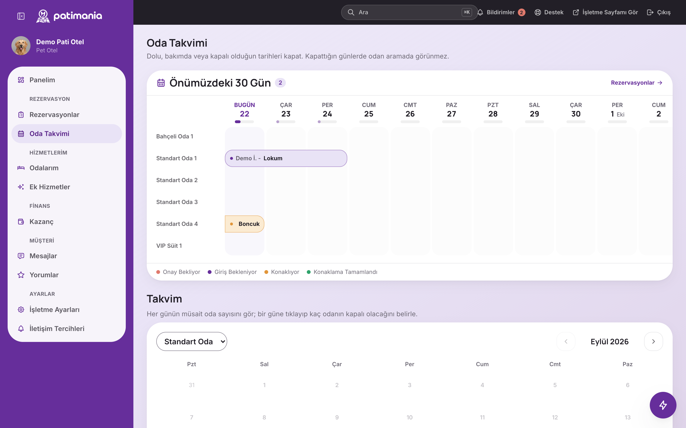

**Patimania** üzerinde çalışıyorum: Türkiye'de evcil hayvan sahiplerini pet otelleri, kuaförler ve pet taksilerle buluşturan bir pazaryeri. Web'de, iOS ve Android'de çalışıyor; arkasında bir işletme paneli ve bir yönetim paneli var. Müşteri ödemeyi baştan yapıyor, para hizmet bitene kadar Ödeme Güvencesi'nde bekliyor; sonra komisyon kesilip kalanı işletmeye geçiyor.

İlk commit 2 Temmuz 2026'da atıldı. Bu yazıda projenin nasıl kurulduğunu anlatıyorum: onu şekillendiren kararları, düzgün çözmem gereken birkaç sorunu ve kodu bir yapay zekâ ajanıyla yazarken öğrendiklerimi.

Önce nerede olduğunu söyleyeyim, olduğundan büyük göstermek istemem. Patimania şu an [patimania.com](https://patimania.com)'da ön yayında. Arama, işletme sayfaları ve işletme kaydı açık; ama şimdiye kadar listelenen işletmelerin hepsi demo kayıt ve ödeme sağlayıcısı bağlanana kadar gerçek ödeme kapalı. Ödeme akışının tamamı hazır, sahte bir sağlayıcıyla test ediliyor. Uygulama Google Play kapalı testinde ve TestFlight dış testinde.

## Üç hizmet, üç ayrı saat

Her şeyi belirleyen karar, üç hizmeti tek bir "randevu" kalıbına sokmamak oldu. Çünkü gerçekten farklılar:

- **Pet otel** gece hesabıyla çalışıyor; her odanın kendi adı var ve her oda ayrı bir kaynak.
- **Kuaför** saat dilimiyle çalışıyor; her çalışan ayrı bir kaynak.
- **Pet taksinin** sabit bir fiyatı hiç yok. Müşteri talep açıyor, şoförler teklif veriyor, müşteri birini seçiyor. Teklif 12 saat geçerli ve bağlı olduğu talepten uzun yaşayamıyor.

Her biri kendi zaman ve kapasite modelini korudu; işletme paneli de buna göre değişiyor: otelde oda takvimi, kuaförde randevu defteri, takside yolculuk listesi.



## Çift rezervasyonu veritabanı reddediyor

İki müşteri aynı odayı aynı gece için asla alamamalı. Uygulama kodunda "önce kontrol et, sonra yaz" yaklaşımı yarış durumunda tutmuyor: iki istek kontrolü aynı anda geçip ikisi birden yazabiliyor.

Bu yüzden kuralı PostgreSQL'e taşıdım. Bir dışlama kısıtı, aynı kaynakta çakışan zaman aralıklarını imkânsız kılıyor:

```sql
EXCLUDE USING gist (
  resource_id WITH =,
  tstzrange(start_at, end_at, '[)') WITH &&
) WHERE (
  exclusive
  AND status IN ('pending_payment','paid','confirmed','in_progress','completed')
);
```

Kodda bir hata olsa da, iki istek aynı mikrosaniyede gelse de veritabanı ikincisini reddediyor. `WHERE` kısmı kısıtı yalnızca gerçekten yer tutan rezervasyonlara uyguluyor: iptal edilen rezervasyon yeri boşaltıyor, taksi teklifleri ise hiç yer tutmuyor.

## Para iki kez hareket etmiyor

Ödeme sağlayıcısının bildirimi iki kez gelebiliyor, kullanıcı "onayla"ya iki kez basabiliyor, zamanlanmış bir iş kullanıcının işlemiyle aynı saniyeye denk gelebiliyor. Durumu değiştiren her yazım koşullu (`UPDATE … WHERE status = 'pending'`); ikinci deneme hiçbir satırı güncellemiyor ve sessizce duruyor.

Bunun etrafında:

- Fiyat, komisyon ve uygunluk her zaman sunucuda hesaplanıyor. İstemciden gelen bir fiyat hiçbir noktada kabul edilmiyor.
- Kilitler hep aynı sırayla alınıyor: önce ödemeler, sonra rezervasyonlar. Yeni bir kod yolu bunu ters sırayla yaparsa CI'daki bir kontrol uyarıyor.
- Paranın her hareketi yalnızca ekleme yapılabilen bir deftere yazılıyor. Temizlik betikleri bile bu tabloya dokunmuyor.

## Kural rezervasyona sabitleniyor

İptal süresi ve komisyon oranı yönetim panelinden değiştirilebiliyor. Bunları değiştirmek geçen hafta yapılmış rezervasyonların kuralını da değiştirseydi, müşteriye verilen söz bozulmuş olurdu. Bu yüzden rezervasyon yapıldığı anda kuralın kendi kopyasını alıyor ve sonraki her karar o kopyaya göre veriliyor.

Bu, projede bir alışkanlığa dönüştü: iş kuralları koda gömülmüyor, bir kural tablosunda duruyor; sayaçlar ayrıca tutulmuyor, tek bir defterden hesaplanıyor.

## Adres sadece haritadaki bir nokta değil

Arama için "Kadıköy" yeterli, ama pet taksinin kapıya gelmesi gerekiyor. Tam adresi baştan istemek ise insanların daha arama yapmadan vazgeçmesine yol açıyordu. Bu yüzden adres iki adımda alınıyor: önce haritadan bir nokta, sonra rezervasyon gerektirdiğinde kapı bilgileri (bina, numara, kat, daire), ayrı alanlarda.

Türkçeye özgü bir tuzak da vardı. Adres eşleştirmede iyelik eki önemli: "Tan Sokak" ile "Tan Sokağı" farklı sokaklar olabiliyor. Basit bir "içeriyor mu" karşılaştırması bunu yanlış yapıyor; eşleştirme Türkçe ek kurallarını ayrıca ele alıyor.

## Unutulamayan yetkiler

Yönetim panelinde 30 ekran var ve her personelin yetkileri ayrı ayrı ayarlanıyor. Yeni bir yönetim ucunda yetki kontrolünü unutmak o ucu bütün personele açıyor, testler de bunu fark etmiyor, çünkü testler genelde yönetici olarak çalışıyor.

Bu yüzden CI'da bir betik bütün yönetim uçlarını tarıyor ve yetki satırı olmayan bir uç bulursa derlemeyi durduruyor. Aynı fikir artık başka sessiz hata türlerini de kapsıyor: kilit sırası, iOS ile Android arasındaki farklar, derin bağlantıların tutarlılığı ve birkaçı daha. Her derlemede bu tür yedi kontrol çalışıyor. Bir hata türü bir kez canımı yaktıysa, hatırlayacağıma güvenmek yerine onu bir makinenin izlemesini tercih ederim.

## Kodu Claude Code ile yazmak

Patimania'yı ilk commit'ten beri Claude Code ile yazıyorum. Dört ayda dört ayrı yüzeyin (API, web, mobil uygulama ve yönetim paneli) çıkabilmesinin sebebi bu. Ama asıl ilginç kısım bu değil.

Asıl ilginç kısım işi denetlemek. Ajan hızlı yazıyor; yanlış yazdığında da aynı hızla ve aynı özgüvenle yanlış yazıyor. Projeyi ayakta tutan, bu hızın etrafına koyduğum kurallar oldu:

1. **Kararlar bende.** Kapsam, veri modeli, mimari ve "bunu yapmıyoruz" demek benim işim; her biri gerekçesiyle yazıya geçiyor, şu ana kadar 102 karar kaydı var. Ajan uyguluyor, karar vermiyor.
2. **Kanıtsız iddia yok.** "Çalışıyor" demek, çalıştığı gösterilene kadar kabul edilmiyor.
3. **Sessiz hatalar makinelere.** Yukarıdaki yedi CI kontrolü, hem insanın hem ajanın kaçırdığını yakalıyor.
4. **Ayrı bir gözden geçirme.** Her aşamanın sonunda kodu yazmamış bir bağlamda inceleme yapılıyor, çünkü kodu yazan, kör noktalarını da beraberinde taşıyor.

76 uçtan uca test paketi ve 3.900 doğrulama buradan geliyor. Her paket gerçek bir API sunucusu ayağa kaldırıyor, izole bir veritabanına gerçek HTTP istekleri atıyor ve sonucu veritabanından kontrol ediyor.

## Mobil uygulamanın öğrettikleri

- **Ağ hatası boş liste demek değil.** İlk sürümde başarısız bir istek "sonuç yok" gibi görünüyordu. Artık her listenin birbirinden ayrı üç hâli var: sonuç var, sonuç yok, bağlantı yok.
- **Görüntü hataları testte görünmüyor.** Uygulamada iOS ile Android arasındaki yerleşim farklarını sayıya çeviren bir tanı ekranı var; böylece göz kararı değil, rakamla karşılaştırılıyor.
- **Native değişiklikler güncellemeyle gitmiyor.** Küçük düzeltmeler mağaza incelemesine girmeden OTA güncellemesiyle çıkıyor, ama açılış animasyonunu değiştirmek yeni bir mağaza derlemesi gerektirdi.

## Bilerek sıkıcı seçimler

Proje modüler bir monolit: tek repo; API, web ve mobil uygulama aynı iş mantığı paketini paylaşıyor. Bu boyutta mikroservisler kazandıracaklarından çok daha pahalıya patlardı. PostgreSQL dört iş birden görüyor (dışlama kısıtı, zaman aralıkları, PostGIS ile coğrafi arama ve iş kuyruğu), bu yüzden ayrıca bir Redis ya da arama sunucusu işletmek gerekmiyor. Sunucu Türkiye'de, çünkü KVKK gereği kişisel verinin yurt içinde kalması gerekiyor.

## Henüz bitmeyenler

- **Gerçek ödeme.** Akış hazır ve test edildi; sağlayıcı bağlantısı henüz kurulmadı, çünkü iyzico ile PayTR arasındaki seçim şirketin kuruluşuna bağlı.
- **Gerçek işletmeler.** Sitedeki işletmelerin hepsi demo kayıt. Bir pazaryerinin asıl zorluğu teknik değil: önce yeterince gerçek işletme gerekiyor.
- **Dosya deposunun geri yükleme denemesi.** Veritabanını geri yükleme provası 23 Ekim'de yapıldı; dosya deposu için henüz denenmedi.
- **Gerçek telefonda bildirimler.** Emülatörde çalışıyor, ama fiziksel bir cihazda henüz görülmedi.

## Rakamlarla

24 Ekim 2026'da ölçüldü: 115 günde 2.441 commit, 315.165 satır TypeScript, 32 backend modülü, 106 yabancı anahtarlı 68 tablo, canlıda 124 migration, 128 web sayfası, 45 uygulama ekranı, 3.900 doğrulamalı 76 uçtan uca test paketi, 7 CI kontrolü ve 102 karar kaydı.

Sırada gerçek ödeme bağlantısı, faturalama ve ilk gerçek işletmeleri platforma almak var. Daha fazla ekran görüntüsünü [proje sayfasında](/tr/projects/patimania) bulabilirsin.
